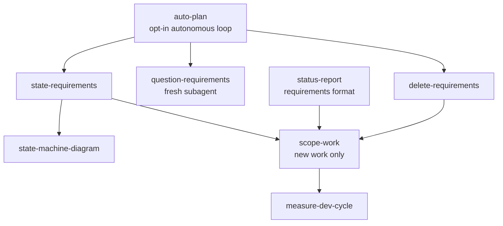

# rstack

A requirements-first agent engineering stack you can install into any project.

`rstack` organizes agent engineering around one core concept: a **requirement**
is anything that motivates a decision — user intent, architecture and owned
code footprint, assumptions, performance or timing metrics, stated
infeasibilities, risks, dependencies, and scoped work estimates. Everything an
agent produces (a plan, an analysis of an implemented feature or codebase
section, a status report, or a dev-cycle profile) is expressible as a unified
set of requirements (`R1`, `R2`, …) that can be stated, questioned in a fresh
subagent, and deleted before writing or keeping custom code.

Interactively, the engineer chooses which skill to run next. When explicitly
triggered, `/auto-plan` autonomously loops plan → state → question → delete
until two consecutive rounds make no requirement changes, then implements and
verifies the plan.

## Install

### Cursor

Add `alxrod/rstack` as a plugin marketplace and install the `rstack` plugin
(installs both `skills/` and always-applied `rules/`).

### Claude Code

```sh
claude plugin marketplace add alxrod/rstack
claude plugin install rstack@rstack
# Or inside a Claude Code session:
# /plugin marketplace add alxrod/rstack
# /plugin install rstack@rstack
```

### OpenAI Codex CLI

```sh
codex plugin marketplace add alxrod/rstack
codex plugin add rstack@rstack
```

### Any Agent Skills harness (`npx skills` / `gh skill`)

Works with Cursor, Claude Code, Codex, Gemini CLI, OpenCode, Pi, and GitHub
Copilot (installs all 8 skills and their bundled scripts into a project or
globally):

```sh
# Inside any project directory:
npx --yes skills add alxrod/rstack --all
# Or with GitHub CLI 2.90+ (pass --agent cursor|claude-code|codex --scope project|user):
gh skill install alxrod/rstack --all --agent cursor --scope project
```

*Tip: pair `rstack` with `benchmark-checklist` from
[backnotprop/pstack](https://github.com/backnotprop/pstack) for rigorous
performance vetting.*

## Skill hierarchy (DAG)

Skills form a directed graph: parent skills invoke child skills, and child
skills stay agnostic to whatever parent called them.



## Included skills

| Skill | Purpose |
| --- | --- |
| [`state-machine-diagram`](plugins/rstack/skills/state-machine-diagram/SKILL.md) | Express any plan, implemented feature, or workflow as a validated Mermaid `stateDiagram-v2` text + visual diagram reflecting performance/timing metrics, backed by [`state_diagram.py`](plugins/rstack/skills/state-machine-diagram/scripts/state_diagram.py) |
| [`state-requirements`](plugins/rstack/skills/state-requirements/SKILL.md) | State all requirements (`R1`, `R2`, …) motivating a plan, an implemented feature or codebase section, or a workflow |
| [`question-requirements`](plugins/rstack/skills/question-requirements/SKILL.md) | Fresh subagent: deep web research for OSS replacements, deletion audit, minimal targeted spikes in disposable directories/worktrees, and parallelism/scope challenges |
| [`delete-requirements`](plugins/rstack/skills/delete-requirements/SKILL.md) | Delete unnecessary requirements/code/steps, adopt OSS, optimize surviving parts, encode surviving requirements in code/data, and verify |
| [`auto-plan`](plugins/rstack/skills/auto-plan/SKILL.md) | Opt-in autonomous loop: plan → state → question → delete until two consecutive rounds make no requirement changes, then implement and verify |
| [`measure-dev-cycle`](plugins/rstack/skills/measure-dev-cycle/SKILL.md) | Profile single-PR and aggregate dev cycles with standalone [`dev_cycle.py`](plugins/rstack/skills/measure-dev-cycle/scripts/dev_cycle.py) and render a single concise HTML **Phase Duration Breakdown** table highlighting long poles |
| [`scope-work`](plugins/rstack/skills/scope-work/SKILL.md) | Derive empirical 10–60 minute work pieces and first-pass / failure-adjusted clock times from historical dev-cycle data |
| [`status-report`](plugins/rstack/skills/status-report/SKILL.md) | Report plan progress in requirements format (`R#`) using `scope-work` derivations |

## Included rules

- [`requirements-first.mdc`](plugins/rstack/rules/requirements-first.mdc) — Requirements-first model + code and data as source of truth
- [`build-and-check-hygiene.mdc`](plugins/rstack/rules/build-and-check-hygiene.mdc) — High-priority warm build discipline + run every check to the end

## Verify locally

```sh
bash scripts/checks.sh
```
